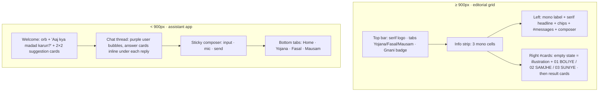

# Implementation Plan: Kisan Saathi UI redesign

## Project context (for the executor)
- Project root: `/media/anish/win/competition/gnani`. FastAPI app; frontend is plain static files in `app/static/` (`index.html`, `style.css`, `app.js`), served at `/` and `/static/*`. No build step.
- Run tests with `scripts/test.sh` (it unsets PYTHONPATH because ROS Humble is on the system PYTHONPATH and disables pytest plugin autoload; it loads pytest_asyncio explicitly). Run the server with `env -u PYTHONPATH .venv/bin/uvicorn app.main:app --port 8000`. JS check: `node --check app/static/app.js`.
- Existing test `tests/test_app.py::test_index_served` asserts `"Kisan Saathi"` is in the page. 89 tests pass before this work; keep them passing.
- Do NOT change backend Python code, `.env`, or the API contract.
- API contract used by the frontend:
  - `POST /api/chat` JSON `{message, session_id, speak?}`; `POST /api/voice` multipart `audio` (webm/ogg/m4a blob) + `session_id`; `POST /api/eligibility` JSON `{profile, session_id, lang}`.
  - Every response: `{transcript, lang ("hi-IN"|"hi-en"|"en-IN"), reply_text, cards[], sources[], audio_b64 (MP3 base64 or null)}`. Errors return `{detail: string}` with 4xx/5xx (429 for rate limit).
- Card data shapes (`card.type` → `card.data`):
  - `scheme`: `{id, title, benefit, documents[], apply, helpline|null, link}`
  - `eligibility`: `{results:[{id, name, status: eligible|already_enrolled|needs_check|not_eligible, reasons[], questions[], benefit, documents[], notes[], link}], profile:{owns_land, land_acres, is_tenant, income_tax_payer, govt_employee_or_pensioner_10k, grows_paddy, registered_on_state_portal, has_kcc, district}}` (booleans may be null)
  - `crop`: `{crop|null, stage|null, title, actions[], source|null, source_url|null, reminder}`
  - `weather`: `{place, days:[{date, label, rain_mm, rain_prob, tmax, tmin}], advisories:[{level: ok|warn|alert, text}]}`
  - `web_sources`: `{title, sources:[{title, url}]}`
- `app.js` features to preserve: localStorage session id (`ks_session`); `el()` helper and text-only DOM insertion (never innerHTML with server data); `safeLink()` allowing only http(s) URLs; card renderers for all 5 types; eligibility profile form (Haan/Nahi/Pata nahi + acres) that POSTs `/api/eligibility` and re-renders; Chart.js weather chart (rain bars + tmax/tmin lines, two y-axes) with text fallback; MP3 playback with 🔊 replay; `lastLang` tracking; MediaRecorder mic with 25 s auto-stop, mime picking (webm/ogg/mp4), echoCancellation/noiseSuppression, ignore blobs < 1000 bytes; busy state; error display from `detail`; example-question chips (Yojana / Fasal / Mausam); welcome bot message.
- Example questions: "Main 2 acre ka kisan hoon, income tax nahi bharta, KCC nahi hai"; "PM-Kisan ke liye kaun se documents chahiye?"; "धान बेचने के लिए टोकन कैसे मिलेगा?"; "Chana mein phool aa rahe hain, sinchai karun?"; "Dhaan mein bhura maahu lag gaya hai kya karun?"; "Bemetara mein agle hafte barish hogi? Gehun mein paani doon?".
- Footer disclaimer: advice is informational; confirm scheme conditions and pesticide/fertilizer doses with local KVK, RAEO or krishi vibhag. Data: Open-Meteo, pmkisan.gov.in, pmfby.gov.in, ICAR / NCIPM.

## Design references
- **Desktop — "Meetly AI" landing page:** off-white background, thin grid lines, small uppercase monospace labels, large serif headline with one accent word, flat rectangular buttons (solid + outlined), isometric line-art illustration, numbered "01 / CAPTURE" step strip.
- **Mobile — "Glean" assistant app:** glowing orb, "How can I help you today?" greeting, 2×2 suggestion cards, chat bubbles with rich answer cards and source chips, rounded composer with mic and send, pill-shaped bottom tab bar. Lavender gradients, large radii, soft shadows.

## Problem Statement
Restyle the working app so the desktop page follows the editorial grid style of the Meetly reference and the mobile page follows the soft assistant-app style of the Glean reference. Both use a purple accent. No backend changes.

## Requirements
1. Accent colour: purple/lavender on desktop and mobile.
2. Desktop: the app only, no landing hero, in Meetly's style.
3. Mobile: Glean's style (orb, greeting, 2×2 suggestions, inline answer cards, pinned composer, pill tab bar).
4. Isometric SVG illustration in purple line-and-fill style (farmer with phone, paddy, rain cloud, scheme document). Shown in the desktop results panel before the first answer, and small next to the mobile greeting.
5. Keep: plain HTML/CSS/JS; IDs `messages`, `chat-form`, `chat-input`, `send-btn`, `mic-btn`, `cards`, `chips`; all five card types and the eligibility form; Chart.js; the "Powered by Gnani Prisma v3.0 & Timbre v3.0" badge.
6. Hindi (Devanagari) must render properly in every font.

## Background
- Remove Pico CSS.
- Fonts (Google Fonts, `display=swap`): Instrument Serif + Tiro Devanagari Hindi (headlines); Inter + Noto Sans Devanagari (body); JetBrains Mono (labels).
- Colours: accent `#7C5CFA`, text accent `#5B3FD6`, soft `#EEE9FF`; ink `#14131A`, muted `#6B6A76`, background `#FAFAFC`, lines `#E6E5EE`. Status: green `#2e7d32`, blue `#1565c0`, orange `#ef6c00`, red `#c62828`.
- Icons: inline SVG `<symbol>` sprite in `index.html`.

## Proposed Solution



- One list of example questions grouped by module drives both desktop chips and mobile suggestion cards; tabs filter it.
- Cards render into `#cards` on desktop and inline under the bot reply on mobile (`matchMedia("(max-width: 899px)")`).
- `<body>` gets `has-chat` after the first message; on mobile this collapses the welcome screen; the Home tab brings it back.
- Orb and mic show listening/thinking states; animations off under `prefers-reduced-motion`.

## Task Breakdown

### Task 1: Design tokens, fonts and base styles
Replace Pico with CSS variables, fonts with Devanagari partners, resets, focus outlines. Test: pytest + new ID/badge test; `node --check`.

### Task 2: Desktop layout
Top bar (serif logo, tabs, outlined Gnani badge), mono info strip, two-column grid with 1px lines, mono label + serif headline with accent word, rectangular chips, chat, rectangular composer, mono footer. Test: ID test; visual check at 1280/1024px.

### Task 3: Illustration and results empty state
`app/static/illustration.svg`; empty state with illustration + "01 / BOLIYE — Gnani Prisma v3.0", "02 / SAMJHE — Gemini + knowledge base", "03 / SUNIYE — Gnani Timbre". Test: SVG served as `image/svg+xml`.

### Task 4: Restyle the result cards
Scheme, eligibility (status pills, segmented Haan/Nahi/Pata nahi form), crop, weather (Chart.js colours from CSS variables), web sources (source chips). Test: `node --check`.

### Task 5: Mobile layout
Orb welcome, 2×2 suggestion cards, gradient user bubbles, white bot cards with orb avatar, inline result cards, pinned composer, pill tab bar, safe-area insets. Test: ID test; no horizontal scroll at 375/390px.

### Task 6: Interaction states, accessibility, wiring
Listening/thinking states, replay button, reduced motion, `aria-label`s, 44px tap targets, tab filtering, Chart.js fallback; commit. Test: full pytest, `node --check`, static files 200 from a local server. Manual: voice on desktop (localhost) and phone (HTTPS after Lightsail deploy).

**Estimate:** about 3–4 hours. Changes stay inside `app/static/` plus one test file.

## Implementation notes (done)
- Chart.js 4.4.4 is self-hosted at `app/static/vendor/chart.umd.min.js` instead of the CDN: in testing the CDN copy sometimes hadn't loaded when the first weather card rendered. `drawWeather` also waits for the script's `load` event and falls back to a text summary.
- On desktop the page is an app shell (`100dvh`): the chat and results panels scroll inside; after the first message the chips collapse into one scrollable row. On short screens (< 820px tall) the info strip and label are hidden.
- `scripts/ui_snap.py` takes screenshots with real phone widths through Chrome DevTools device emulation and reports horizontal overflow (headless `--window-size` can't go below ~500px wide).
- Verified: 97 tests pass; no horizontal overflow at 360/375/390 px; desktop checked at 1024×768, 1280×800/900 and 1440×900; all five card types plus the eligibility form, tab filtering and a live end-to-end question on the mobile layout.

## Optional: Neon project (approved earlier)
Create the Neon project without touching app code, if `neon` commands are permitted:
```bash
cp .env .env.bak
neon orgs list
neon link --org-id <ORG_ID> --project-name kisan-saathi --region-id aws-ap-southeast-1 --no-env-pull
neon env pull --file .env.neon
```
`.env.neon` is git-ignored by the `.env.*` rule.
