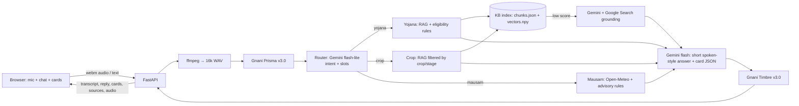

# Implementation Plan: Kisan Saathi CG (voice farm assistant for Chhattisgarh)

**FIRST ACTION (before Task 1):** Create `plan.md` in the project root containing this entire plan verbatim (Markdown, including the mermaid diagram).

**Note on .env:** The user already created a `.env` file containing their Gnani API key and Gemini API key. Read only the variable NAMES in `.env` (never print or log the values) and map them in settings. If the names aren't valid env-var identifiers (e.g. contain spaces), ask the user to rename them to `GNANI_API_KEY` and `GEMINI_API_KEY`. Don't overwrite `.env`. Make sure `.env` is in `.gitignore`, and create `.env.example` with placeholder values only.

## Problem Statement
Farmers in Chhattisgarh have trouble finding out which government schemes they qualify for, getting crop advice for the current stage of their crop, and turning weather forecasts into decisions on the farm. Most existing portals are text-heavy and in English. This MVP is a voice-first web app in Hindi, English and Hinglish, built for the Gnani AI "Great Indian AI Internship Challenge". Deadline: 11:59 PM IST on Nov 10, 2026. The public LinkedIn/X post has to be live before submission.

## Requirements
1. Module order: Yojana Saathi first, then Crop Saathi, then Mausam Saathi. Each module should be shippable on its own.
2. Interface: a web page with a mic button, a chat box, and visual result cards (scheme cards, an eligibility checklist, crop cards, a weather chart).
3. Stack: Python (FastAPI), solo developer. Deployed on AWS Lightsail.
4. Speech: Gnani Prisma v3.0 converts speech to text, and Gnani Timbre v3.0 converts text to speech (v2.5 is the fallback).
5. Reasoning: Gemini, with RAG over a curated knowledge base.
6. Web search fallback: when the knowledge base has no good match, search the web through Gemini's Google Search grounding and show the sources.
7. Yojana Saathi does both conversational Q&A and a rule-based eligibility checker. The farmer's profile can come from speech or from a form.
8. Knowledge base scope: paddy plus 3 rabi crops (chana, wheat, teora/lathyrus), and 5 schemes.
9. Languages: Hindi, English and Hinglish. Chhattisgarhi is out of scope.

## Background (research)
- **Prisma REST:** `POST https://api.vachana.ai/stt/v3`, header `X-API-Key-ID: <key>`, multipart field `audio_file`, form fields `model=prisma-v3.0` and `language_code=indic-auto`. The response contains `transcript` and `detected_language_code`. Clips can be at most 30 seconds. Accepted formats: WAV, MP3, OGG, FLAC, AAC, M4A, at 8–44.1 kHz. `en-IN` accepts Hindi-English mixed audio and returns Latin script; `hi-IN` returns Devanagari. Docs: https://docs.gnani.ai/api/introduction/quick-start
- **Browser audio format:** `MediaRecorder` produces webm/opus, which isn't accepted. The server converts it to 16 kHz mono WAV with ffmpeg.
- **Timbre REST:** `POST https://api.vachana.ai/api/v1/tts/inference`, header `X-API-Key-ID`, JSON body `{text, voice, model, language, speed, audio_config:{sample_rate, num_channels, sample_width, encoding:"linear_pcm", container:"wav"}}`. Returns WAV bytes. Timbre v3.0 voices (Female: Shivani, Lakshmi, Kalpana, Chetana, Vasudha, Riyaa, Tarika. Male: Avinash, Shubham, Prakash, Devansh, Yashraj, Harshad) speak all 10 languages. Timbre v2.5 voices are tied to one language: Nalini for `hi-IN`, Poorvi for `hi-en`, Kaveri for `en-IN`. Voices aren't interchangeable between models; a mismatch returns 400. Timbre's text normalization reads amounts like ₹6,000 naturally. Docs: https://docs.gnani.ai/api/TTS/available-voices
- **Gemini:** use the `google-genai` SDK. Answers: `gemini-3.8-flash`. Cheap intent and slot extraction: `gemini-3.5-flash-lite`. Embeddings: `gemini-embedding-2` with `output_dimensionality=768`. It auto-normalizes, and it does NOT support `task_type`, so put task instructions in the text. Web search: `types.Tool(google_search=types.GoogleSearch())`, with source URLs read from the grounding metadata. Run the search as its own call, separate from the knowledge-base answer and function calling. Verify the model names at build time.
- **Weather:** the Open-Meteo forecast API and geocoding API are free and need no key. They provide daily precipitation, min/max temperature and humidity.
- **HTTPS on Lightsail:** browsers allow mic access only over HTTPS. Caddy gets a Let's Encrypt certificate automatically for the free `<static-ip>.sslip.io` hostname.
- **Credits:** registration gives 5,000 Gnani programme credits. Cache TTS audio and rate-limit requests.

## Starter knowledge base
(Task 5 includes verifying every fact against the official source.)

### Crops

| Crop | Why it's included | Topics to cover |
|---|---|---|
| Paddy (dhaan) | Chhattisgarh's main kharif crop | Varieties (e.g. MTU-1010, Swarna, IGKV's Rajeshwari and Indira varieties), nursery and transplanting, fertilizer by stage, pests (stem borer, brown planthopper, gundhi bug), diseases (blast, sheath blight, bacterial leaf blight), harvest and storage |
| Chana (gram) | The main rabi pulse | Sowing window, seed treatment, wilt, pod borer, irrigation at flowering, frost care |
| Wheat (gehun) | Rabi cereal in irrigated pockets | Sowing date, the critical irrigation stages (crown root, flowering, grain filling), rust, heat stress |
| Teora / lathyrus (utera) | Relay crop sown into standing paddy, typical of Chhattisgarh | Utera method, seed rate, moisture management |

### Schemes

| Scheme | What the checker's rules test |
|---|---|
| PM-Kisan (₹6,000 a year) | Owns land, isn't an income-tax payer, isn't a government employee or a pensioner with ₹10,000 or more a month, isn't an institutional landholder |
| Krishak Unnati Yojana (Chhattisgarh) | Grows paddy or other eligible crops, is registered on the state's integrated farmer portal, sells through a cooperative society |
| PM Fasal Bima Yojana | Grows a notified crop in a notified area. Farmer premium is about 2% for kharif and 1.5% for rabi. Loanee and non-loanee farmers both qualify |
| Kisan Credit Card | Is a cultivator (owner, tenant or sharecropper). Covers the interest subvention and the credit limit |
| Soil Health Card | Every farmer is eligible. Covers how to get the soil tested |

Optional sixth scheme: PM-KUSUM or Chhattisgarh's Saur Sujala solar-pump scheme.

### Sources
- Crops: IGKV Raipur package of practices (igkv.ac.in), the Chhattisgarh agriculture department (agriportal.cg.nic.in), ICAR-NRRI Cuttack for rice, ICAR-IIPR for chana, ICAR-IIWBR for wheat, farmer.gov.in.
- Schemes: pmkisan.gov.in, pmfby.gov.in, myscheme.gov.in, soilhealth.dac.gov.in, the Chhattisgarh government's Krishak Unnati pages.
- Weather: IMD Gramin Krishi Mausam Seva district bulletins as reference text for the advisory rules.

## Proposed Solution

- **Single response format:** every endpoint returns `{transcript, lang, reply_text, cards[], sources[], audio_b64}`. The frontend renders cards by `type`: `scheme`, `eligibility`, `crop`, `weather`, `web_sources`.
- **Language handling:** `detected_language_code` picks the reply language. Devanagari text goes to `hi-IN`, and Latin-script Hinglish goes to `hi-en` or `en-IN`.
- **Safety:** pesticide doses come only from knowledge-base text. Web answers are labelled "web se" and list their sources. Every advisory ends by telling the farmer to confirm with the local KVK or RAEO.
- **Layout:** `app/` holds `main.py`, `config.py`, `pipeline.py`, `clients/` (gnani, gemini, weather), `modules/` (yojana, crop, mausam), `rag/` and `static/`. Next to it: `kb/` (curated Markdown with front-matter), `scripts/` (ingest, smoke), `tests/`. Secrets live only in `.env`, which is never committed or logged.

## Task Breakdown

Suggested timeline: Tasks 1–4 by noon on Nov 9, Tasks 5–7 by the night of Nov 9, Tasks 8–9 by noon on Nov 10, the post live by about 3 PM on Nov 10, and submission by 9 PM. If time runs short, cut Mausam Saathi down to a weather card plus rule-based advisories.

### Task 1: Project skeleton with a text chat page
- Objective: a FastAPI app that serves one page with a chat box and a mic button. The mic button doesn't work yet.
- Guidance: use `pydantic-settings` to load the existing `.env` (map the user's variable names). Add `GET /health`, and `POST /api/chat` returning the single response format with an echo reply. Build the frontend in plain HTML and JS with a CDN CSS library, using chat bubbles and a card container. Set up pytest, `requirements.txt`, `.env.example` and `.gitignore`.
- Tests: `/health` returns 200. `/api/chat` returns the response format. Empty or overlong input gets a 422.
- Demo: open localhost, type a message, and see it echoed in a chat bubble.

### Task 2: Voice loop with Prisma and Timbre
- Objective: speak into the mic and hear the transcript spoken back.
- Guidance: the frontend records with `MediaRecorder` and stops automatically at 25 seconds. `POST /api/voice` accepts the audio as multipart form data. On the server, ffmpeg converts it to 16 kHz mono WAV. Then `GnaniSTT.transcribe()` calls Prisma v3.0 with `indic-auto`, and `GnaniTTS.speak(text, lang)` calls Timbre v3.0, falling back to v2.5 with the matching voice. Use timeouts and clear errors. Cache TTS audio by a hash of text, language and voice.
- Tests: mock HTTP with `respx` to cover request building, the language-to-voice mapping, error handling and the cache hit. Add `scripts/smoke_gnani.py` that runs real API calls.
- Demo: say "Namaste, main Raipur se hoon", see the transcript, and hear it spoken back in Hindi.

### Task 3: Gemini answers in chat and voice
- Objective: replace the echo with Gemini answers, for both typed and spoken input.
- Guidance: `GeminiClient` with a system prompt: you are Kisan Saathi for Chhattisgarh farmers; answer in the farmer's language and script; keep answers to 2–4 short sentences that sound natural when spoken; never invent amounts or doses. Keep the last 6 turns in memory, keyed by a session ID. Both endpoints share `pipeline.handle(text, lang, session_id)`.
- Tests: mock Gemini to check the pipeline output format, prompt assembly with history, and the reply language matching the detected language.
- Demo: ask by voice "Rabi mein kya bo sakte hain?" and hear a short spoken answer.

### Task 4: Early deployment to AWS Lightsail
- Objective: put the voice loop on a public HTTPS URL so mic access works on a phone.
- Guidance: Ubuntu 24.04 Lightsail instance with 1–2 GB RAM. Attach a static IP. Open ports 80 and 443. Install python3-venv, ffmpeg and Caddy. Run uvicorn under systemd. Configure Caddy for `<ip>.sslip.io` (automatic HTTPS). Copy `.env` with `scp` and restrict it to mode 600. Add a `deploy.sh` (git pull, pip install, restart). Add a simple per-IP rate limit. Write these steps as a doc/scripts, and ask the user before running anything on AWS.
- Tests: run the smoke script against the public URL and use the mic from a phone.
- Demo: open the sslip.io URL on a phone, speak, and hear the answer.

### Task 5: Yojana Saathi Q&A over the knowledge base (RAG)
- Objective: answer scheme questions from the curated knowledge base, with a scheme card.
- Guidance: write `kb/schemes/*.md`, one file per scheme with front-matter and sections for benefits, eligibility, exclusions, documents, how to apply and the official link. Verify each fact from the starter sources, and mark anything unverified. Write `kb/schemes.json` holding the structured card data and rules. Write `scripts/ingest.py`: split the files at headings, embed with `gemini-embedding-2` at 768 dimensions, and save `chunks.json` plus `vectors.npy` (committed). The retriever uses cosine similarity with a metadata filter (`module=yojana`) and returns the top 4 chunks. Gemini answers using only the context, and the app attaches the matched scheme card.
- Tests: the splitter keeps front-matter metadata. With fake vectors, the retriever ranks and filters correctly. The answer prompt contains the context and the "use only the context" instruction.
- Demo: ask "PM-Kisan ke liye kaun se documents chahiye?" and get a spoken answer plus a PM-Kisan card with a link.

### Task 6: Eligibility checker driven by voice or form
- Objective: build the farmer's profile from speech or a form, then list the matching schemes.
- Guidance: define a `FarmerProfile` model (`owns_land`, `land_acres`, `is_tenant`, `income_tax_payer`, `govt_employee_or_pensioner_10k`, `grows_paddy`, `registered_on_state_portal`, `has_kcc`, `district`; all optional). Gemini flash-lite extracts the fields from speech as JSON that matches a schema. A pure-Python rules engine reads the rules from `schemes.json` and returns eligible, not eligible or "needs check" per scheme, with reasons and missing documents. In the UI, the form is pre-filled from the extracted fields and has toggles to correct them; re-checking needs no LLM call. Add `POST /api/eligibility`.
- Tests: table-driven tests for each scheme rule (PM-Kisan exclusions, tenant farmers and KCC, unknown fields producing "needs check"). Mock the extraction.
- Demo: say "Main 2 acre ka kisan hoon, income tax nahi bharta, KCC nahi hai" and see checklist cards plus a spoken summary.

### Task 7: Web search fallback with sources
- Objective: when the knowledge base has no good answer, search the web and show the sources.
- Guidance: if the top retrieval score is below a configurable threshold (start at about 0.6 and tune it on 10 test questions), make a separate Gemini call with Google Search grounding. Extract the source URLs and return a `web_sources` card. The reply starts with "web jaankari ke anusaar…". Log every fallback.
- Tests: with a mocked low score, the router takes the fallback path. With a high score, it doesn't. Source extraction is tested against a sample of grounding metadata.
- Demo: ask "Is saal dhaan ka samarthan mulya kitna hai?" and get an answer with clickable sources.

### Task 8: Intent router and Crop Saathi
- Objective: route each question automatically, and answer crop questions with stage-specific advice.
- Guidance: the flash-lite router returns `{intent: yojana|crop|mausam|general, crop?, stage?, district?}` in one call. Write `kb/crops/{paddy,chana,wheat,teora}.md` with front-matter tags for `crop`, `stage` (sowing, vegetative, flowering, maturity, post-harvest) and `topic` (fertilizer, pest, disease, irrigation, variety). Retrieval filters by crop and stage when they're known. The crop card shows the stage, the actions to take and a KVK reminder. Re-run ingest.
- Tests: route sample questions using mocked JSON. Check that retrieval filters by crop and stage. Pesticide doses in answers must appear in the retrieved text.
- Demo: ask "Chana mein phool aa rahe hain, sinchai karun?" and get stage-specific advice plus a crop card. A scheme question still goes to Yojana.

### Task 9: Mausam Saathi
- Objective: weather-aware advice for the farmer's district and crop.
- Guidance: `WeatherClient` geocodes the district name restricted to Chhattisgarh (falling back to a small coordinates table for the main districts) and fetches a 7-day Open-Meteo forecast, cached for 30 minutes. A pure-function rules engine applies: rain over 10 mm in the next 48 hours means postpone irrigation and spraying. A minimum temperature under 8°C means frost precautions for chana and wheat. A maximum temperature over 35°C at wheat flowering means heat stress. High humidity with cloud means warnings for blast and pod borer. Gemini combines the rule results with the crop context into a spoken answer. The weather card is a 7-day bar chart (Chart.js from a CDN) with advisory chips.
- Tests: the rules engine on fixed forecast data, Open-Meteo responses mocked with `respx`, and the router sending weather questions to Mausam.
- Demo: ask "Bemetara mein agle hafte barish hogi? Gehun mein paani doon?" and see the chart and advisories and hear the answer.

### Task 10: Polish, redeploy and submission
- Objective: a stable demo and a complete entry.
- Guidance: example-question chips for each module, loading and error states, a disclaimer in the footer, and a "Powered by Gnani Prisma v3.0 and Timbre v3.0" badge. Run `deploy.sh` (with user approval). Test all three modules on a phone over mobile data. Draft a 60-second video script: the problem, the eligibility check by voice, a crop question, a weather question, the web sources. Draft the LinkedIn/X post text tagging Gnani AI with #GnaniAI and #GreatIndianAIInternshipChallenge. Draft the submission's written explanation and the models used (Prisma v3.0, Timbre v3.0, Gemini for reasoning). The user records, posts and submits.
- Tests: the full pytest suite passes, and smoke tests pass against production.
- Demo: the public URL works end to end, and the post is live before submission.
