# Kisan Saathi CG — how it works

Kisan Saathi is a voice-first assistant for farmers in Chhattisgarh. A farmer taps the mic and asks a question in Hindi or Hinglish; the app answers out loud in the same language and shows a card with the details. It covers three areas: government schemes (**Yojana Saathi**), crop care (**Crop Saathi**) and weather-based advice (**Mausam Saathi**).

- **Live app:** https://kisan-saathi.duckdns.org/
- **Demo video:** https://youtu.be/phamRC-49Hc
- **Built by:** Anish Deep Toppo, final-year B.Tech (Data Science & AI), IIIT Naya Raipur

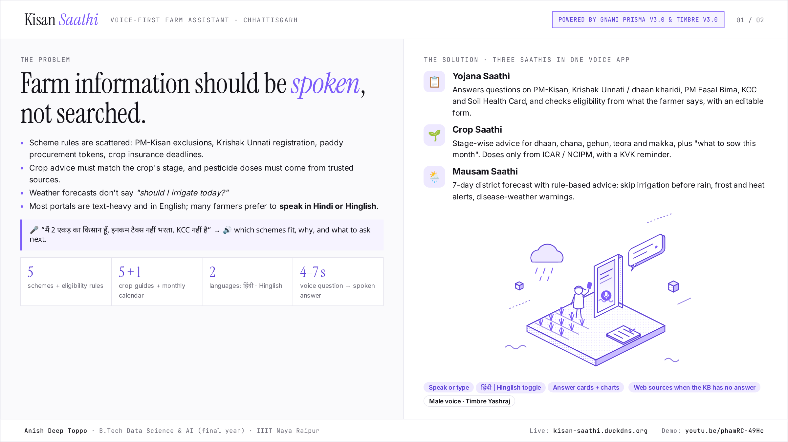

---

## 1. What the farmer sees

The page works on desktop and phones. On a phone it opens on a greeting, four suggestion cards and a mic button; answers and their cards appear in the chat. A **हिंदी | Hinglish** toggle switches the whole page and the language of every reply.

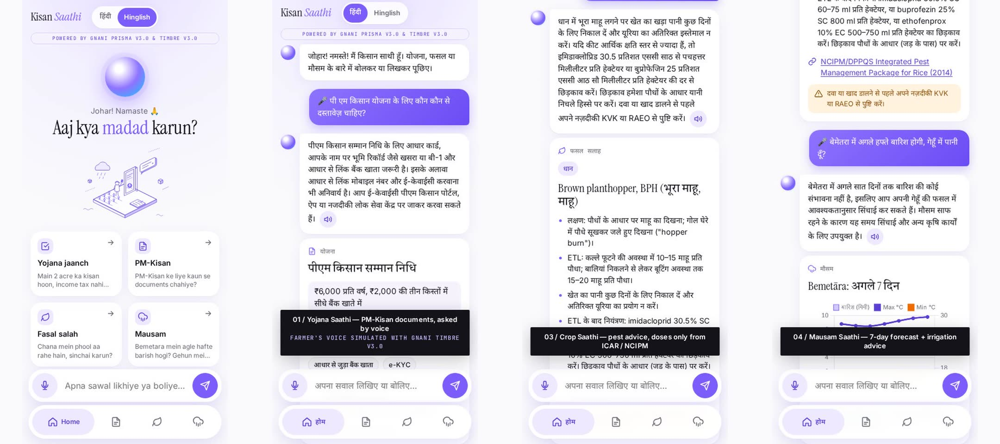

On desktop the chat is on the left and the result card on the right.

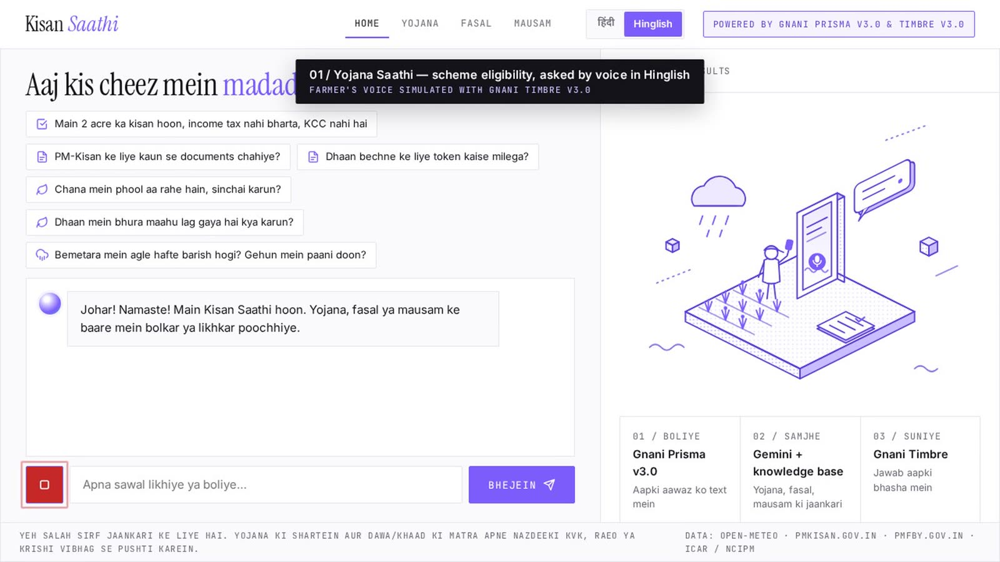

---

## 2. One question, end to end

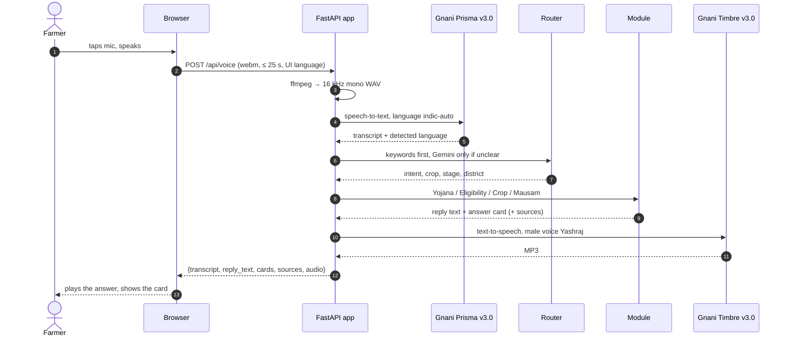

1. **Record.** The browser records up to 25 seconds with the microphone. Typed questions skip steps 1–3 and go to `/api/chat`.
2. **Convert.** The server turns the recording into 16 kHz mono WAV with ffmpeg (Prisma does not accept browser webm).
3. **Listen — Gnani Prisma v3.0.** Speech-to-text with `language_code=indic-auto`, which handles Hindi, English and code-mixed Hinglish and returns the language it heard.
4. **Pick the reply language.** The हिंदी | Hinglish toggle decides; without it, the reply follows what Prisma detected.
5. **Route.** Most questions are clear from their words (मौसम / बारिश → weather, धान / चना / मक्का → crop, PM-Kisan / टोकन → schemes, "main 2 acre ka kisan hoon…" → eligibility). These skip the Gemini call. Unclear questions and follow-ups ("uske liye khaad?") go to Gemini 3.1 Flash-Lite, which returns the intent, crop, stage and district as JSON.
6. **Answer.** The module builds the reply from the knowledge base or live data (section 3).
7. **Speak — Gnani Timbre v3.0.** The reply is read out by the male voice **Yashraj** (Devanagari Hindi with `hi-IN`, Roman Hinglish with `auto`). If v3.0 fails, Timbre v2.5 Deepak or Pranav is used. Repeated answers come from a small audio cache.
8. **Show.** The browser plays the MP3 and renders the card: scheme, eligibility, crop, weather, web sources or general.

A voice question takes about **4–7 seconds** from the end of speaking to the start of the spoken answer.

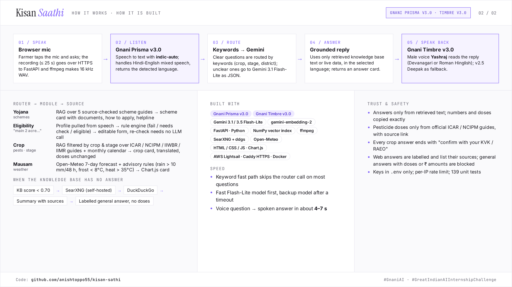

---

## 3. The modules

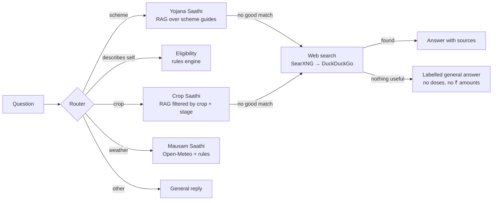

### Yojana Saathi — scheme questions

Covers **PM-Kisan, Krishak Unnati Yojana / paddy procurement, PM Fasal Bima Yojana, Kisan Credit Card and Soil Health Card**. Each scheme has a guide in `kb/schemes/*.md` with benefits, eligibility, exclusions, documents and how to apply, checked against official pages (front matter records the source).

The question is embedded and compared with the knowledge base; the 4 closest sections go to Gemini with the rule *answer only from this text, copy numbers exactly, otherwise reply NO_ANSWER*. The card shows the benefit, documents, how to apply, helpline and official link.

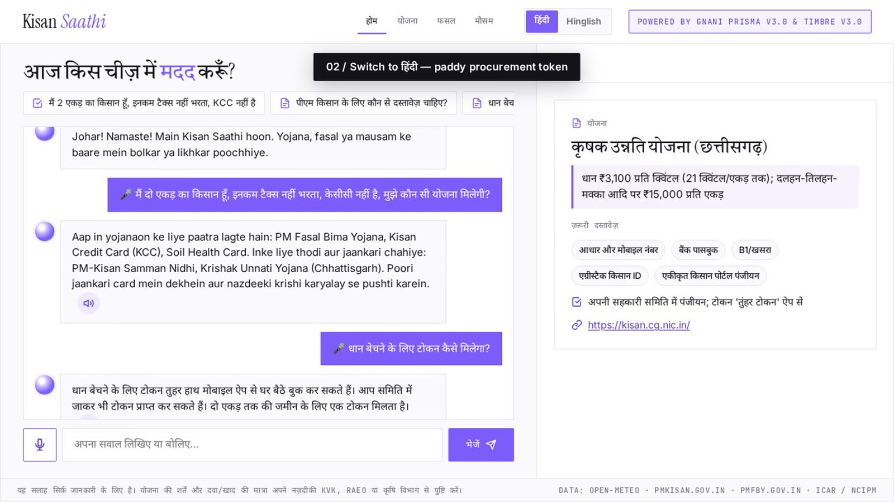

### Eligibility check

When a farmer describes themselves ("मैं 2 एकड़ का किसान हूँ, इनकम टैक्स नहीं भरता, KCC नहीं है"), Gemini pulls out a profile (owns land, acres, tenant, income-tax payer, government job or pension, registered on the state portal, grows paddy, has KCC). Fields not mentioned stay unknown — the app never guesses.

A plain Python rules engine reads the conditions from `kb/schemes.json`:
- a failed condition → **not eligible**, with the reason;
- an unknown condition → **needs check**, with the question to ask;
- all conditions met → **eligible** (or **already has it**, e.g. KCC).

The card shows every scheme with its status and an editable Haan / Nahi / Pata nahi form. Re-checking from the form runs only the rules, with no AI call. The profile is remembered for the rest of the conversation.

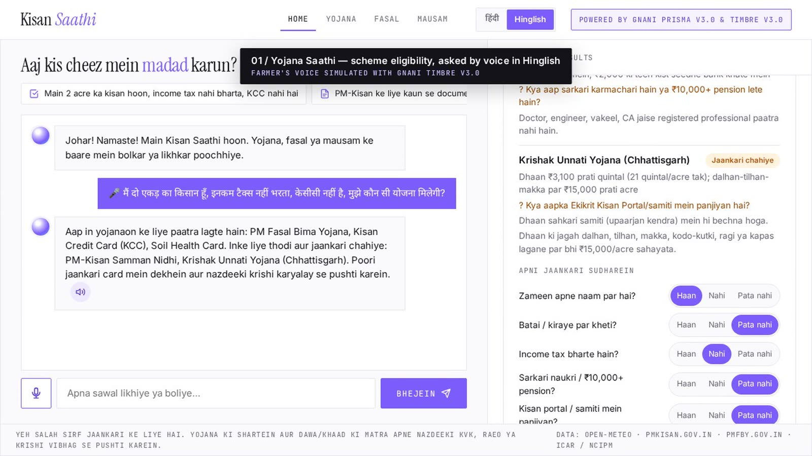

### Crop Saathi — crop advice

Guides for **paddy, chana, wheat, teora (lathyrus) and maize** plus a **month-by-month sowing calendar** for the Chhattisgarh plains (`kb/crops/*.md`). Each section is tagged with crop, stage (sowing, vegetative, flowering, maturity, post-harvest) and topic, so a question about "chana at flowering" only searches the matching sections. For "what should I sow now?" the current month's calendar entry is put first, and the prompt includes today's date.

Pest and fertilizer doses come only from official sources — the NCIPM/DPPQS integrated pest management packages for rice, chickpea, wheat and maize, ICAR-IIWBR wheat advisories, the ICAR-IIMR maize bulletin and the ICAR Rabi Agro-Advisory for Chhattisgarh. The card links to the source and always ends with *"confirm with your nearest KVK or RAEO"*. In Hindi mode the card text is translated; if a number changes in translation, the English text is kept.

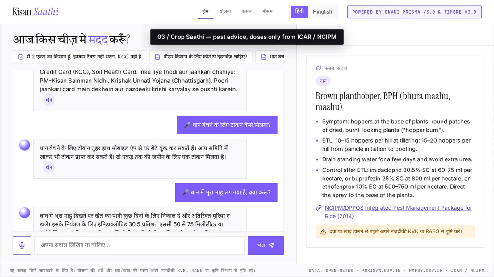

### Mausam Saathi — weather advice

The district is found from the question (Hindi or English names), geocoded within Chhattisgarh, and a 7-day forecast is fetched from **Open-Meteo** (cached for 30 minutes). Simple rules turn the numbers into advice:

| Condition | Advice |
|---|---|
| More than 10 mm rain in the next 48 hours | postpone irrigation and spraying |
| Minimum temperature below 8 °C | frost care for chana, wheat, teora |
| Maximum above 35 °C at wheat flowering | light evening irrigation (heat stress) |
| Humidity ≥ 80 % with cloud ≥ 60 % | watch for blast in paddy, pod borer in chana |

Gemini answers the farmer's actual question ("should I irrigate wheat?") using only these numbers and rules. The card shows a 7-day rain and temperature chart.

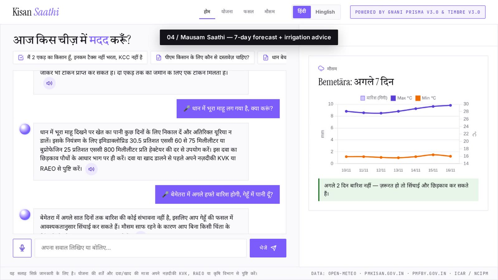

### When the knowledge base has no answer

If the best match scores below **0.70**, or Gemini says the text does not answer the question:

1. **Free web search** through a self-hosted **SearXNG** instance (no API key or billing), with **DuckDuckGo** (`ddgs`) as a backup. Government, ICAR and agricultural-university sites are ranked first.
2. Gemini answers **only from the numbered search results** and names the ones it used; the card lists them as links. Search results are treated as untrusted text, never as instructions.
3. If nothing useful is found, Gemini gives a short **labelled general answer** — *"सामान्य जानकारी — KVK से पुष्टि करें"* — with a rule against doses, quantities, prices and scheme amounts. A check rejects any such answer that still contains a dose or a ₹ amount and replaces it with a referral to the KVK.

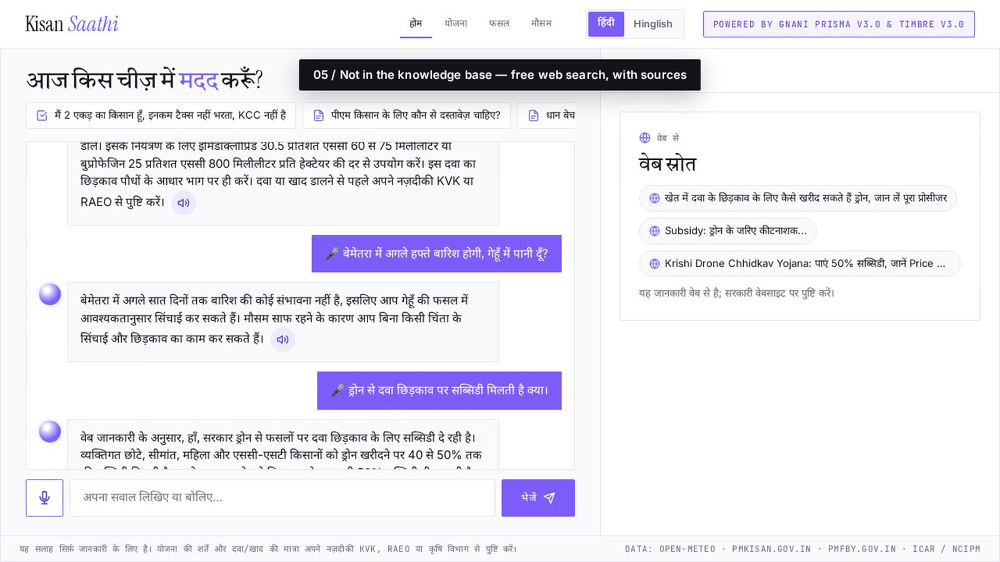

---

## 4. The knowledge base

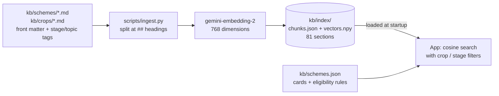

- Written by hand from official sources, in Markdown; each `##` section becomes one searchable chunk.
- `scripts/ingest.py` embeds the sections once and saves the index, which is committed to git. The server only loads it, so starting the app uses no embedding quota.
- Today: 5 scheme guides and 6 crop files, **81 sections** (31 schemes, 50 crops). To change it: edit the Markdown, run `ingest.py`, commit and redeploy.

---

## 5. Models and how they are used

| Job | Model | Notes |
|---|---|---|
| Speech-to-text | **Gnani Prisma v3.0** | `indic-auto`, code-mixed Hindi/English |
| Text-to-speech | **Gnani Timbre v3.0** (Yashraj) | v2.5 Deepak / Pranav fallback; voice set by `TTS_VOICE` |
| Answers | Gemini 3.1 Flash-Lite → 3.5 Flash-Lite → 3.6 Flash | first two have 500 free requests/day each |
| Routing, profile extraction, card translation | Gemini 3.1 Flash-Lite → 3.5 Flash-Lite | skipped for clear questions |
| Retrieval | gemini-embedding-2 | one call per question |

Each Gemini attempt has a time limit (9 s for answers, 5 s for small JSON tasks). A slow call, a quota error, a "high demand" error or an empty / malformed answer moves on to the next model instead of making the farmer wait or showing an error.

---

## 6. How it is deployed

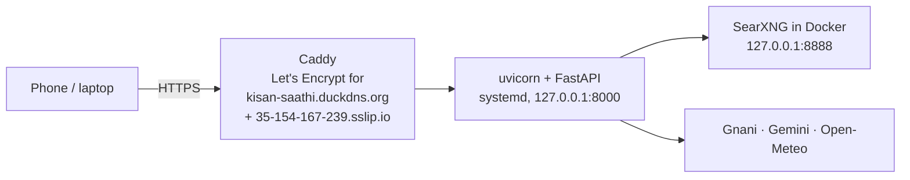

- **AWS Lightsail**, Ubuntu 24.04, 2 GB RAM, Mumbai region, static IP. Only ports 22, 80 and 443 are open.
- **Caddy** provides HTTPS (browsers allow the microphone only over HTTPS) for the DuckDNS name and the sslip.io name.
- The app runs as one uvicorn worker under systemd; SearXNG runs in Docker and is reachable only from the server.
- API keys live only in `.env` on the server (mode 600). A per-IP limit of 20 requests per minute protects the free quotas.
- `deploy/setup_server.sh` sets up a fresh server; `deploy/deploy.sh` pulls new code and restarts. See [deploy/README.md](deploy/README.md).

---

## 7. Safety and quality

- Answers use only retrieved text or live data; numbers and doses are copied, never invented.
- Pesticide doses come only from official ICAR / NCIPM documents, with a source link and a KVK / RAEO reminder.
- Web answers are labelled and show their sources; unsourced general answers cannot contain doses or money amounts.
- The eligibility result comes from fixed rules, not from the AI; unknown facts become "needs check".
- Server text is always inserted into the page as text, never as HTML.
- **139 unit tests** (all external APIs mocked) cover the Gnani clients, routing, retrieval filters, eligibility rules, web-search fallbacks, weather rules and the page's text in both languages (`scripts/test.sh`).

---

## 8. Known limits

- Conversation history and farmer profiles are kept in memory and are lost when the server restarts.
- The knowledge base changes only when someone edits it and re-runs the ingest script; web answers are not saved.
- Free-tier Gemini limits (about 500 requests per day per Flash-Lite model) cap daily use.
- Some search engines block cloud-server IPs, so web search on the server may find fewer results than on a laptop.
- Chhattisgarhi, Halbi and Gondi are not supported by the speech models, so the app uses Hindi and Hinglish.

Planned next: store the knowledge base, conversations and web answers in Neon Postgres (vector search with `lakebase_vector`) so they survive restarts and sync automatically.
